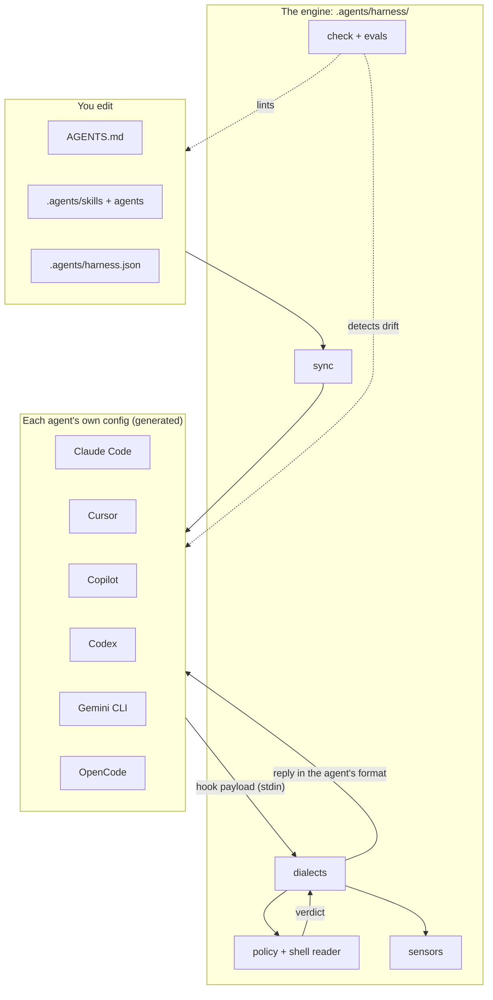

# 2. Anatomy of this harness

This chapter is the tour. It shows where each part lives, then follows one tool call, one edit, one "I'm done" and one session start through the code.

## The layout

```
AGENTS.md                      the map every agent reads first
.agents/
  harness.json                 configuration: agents, sensors, policy overrides
  skills/<name>/SKILL.md       skills, shared by every agent
  agents/<name>.md             subagent definitions (explorer, reviewer)
  plans/                       research and plans in progress
  harness/                     the engine (zero dependencies)
    cli.mjs                    check · sync · eval · install · new-skill
    hooks/
      guard.mjs                before a tool call   → allow | ask | deny
      feedback.mjs             after an edit        → run the fast checks
      stop-gate.mjs            when the agent stops → run verification
      session-start.mjs        at session start     → a few lines of state
      run.mjs                  shared entry: read stdin, find the project, never crash
    lib/
      shell.mjs                reads a command line into commands, args, pipes, redirects
      policy.mjs               the rules, as pure functions
      dialects.mjs             each agent's payload and reply format
      sensors.mjs              post-edit checks and the stop gate
      session.mjs              what a new session is told
      sync.mjs                 generates every agent's wiring
      check.mjs                lints the harness
      evals.mjs  install.mjs  frontmatter.mjs  glob.mjs  util.mjs
    templates/                 AGENTS.md and SKILL.md starters
docs/conventions/              this repository's rules, one per file
docs/tutorial/                 you are here
evals/                         policy.jsonl · triggers.jsonl
tests/                         node --test
```

Everything else at the root (`CLAUDE.md`, `.claude/`, `.cursor/`, `.github/hooks/`, `.codex/`, `.gemini/`, `.opencode/`) is generated by `harness sync` from the files above.

## Three layers



The design rule that keeps this manageable: **agent-specific knowledge lives in two files.** `lib/dialects.mjs` knows what each agent sends and expects back. `lib/sync.mjs` knows where each agent keeps its config. The policy, the sensors and the linter never mention an agent by name.

## The life of one tool call

The agent decides to run `cat .env`. Here is what happens in Claude Code.

1. **The agent's own harness fires its pre-tool hook.** `.claude/settings.json` has a `PreToolUse` entry for `Bash|PowerShell|Read|Grep|Edit|Write|...` that runs `node .agents/harness/hooks/guard.mjs --agent claude`, with the tool call as JSON on stdin:

   ```json
   { "hook_event_name": "PreToolUse", "tool_name": "Bash", "tool_input": { "command": "cat .env" } }
   ```

2. **`run.mjs` reads stdin and finds the project.** It loads `.agents/harness.json` and merges your policy over the defaults.

3. **`dialects.mjs` normalizes the payload.** Whatever the agent sent, the result has one shape: `{ kind: 'shell', command: 'cat .env' }`. For a file tool it would be `{ kind: 'read', paths: [...] }`.

4. **`shell.mjs` reads the command.** It yields one command: name `cat`, args `['.env']`. It would also unwrap `sudo`, follow `bash -c "..."`, and look inside `$(...)`.

5. **`policy.mjs` runs the rules.** `cat` is a command that reads files, and `.env` matches the secret paths, so the `secret-file` rule fires with its default decision, `deny`. If several rules fire, the most severe wins.

6. **`dialects.mjs` writes the reply in Claude Code's format:**

   ```json
   { "hookSpecificOutput": { "hookEventName": "PreToolUse", "permissionDecision": "deny",
     "permissionDecisionReason": "Blocked by harness policy [secret-file] (.env): This path holds credentials. Do not read, copy or upload it. Read the example file (such as `.env.example`) for the variable names, or ask the user." } }
   ```

7. **The agent reads the reason and continues.** The command never ran. In a real run of this exact case, the agent replied that the policy blocked it and offered to read `.env.example`.

In Cursor the same steps run with a different first and last step: the payload is `{ "hook_event_name": "beforeShellExecution", "command": "cat .env" }` and the reply is `{ "permission": "deny", "agent_message": "..." }`. Steps 2 to 5 are identical. That is the whole portability story, and [chapter 8](08-portability.md) covers it.

## The life of one edit

The agent edits `.agents/skills/git-commit/SKILL.md` and removes the "Use when" sentence from its description.

1. The post-tool hook runs `hooks/feedback.mjs`.
2. `sensors.mjs` looks up `sensors.postEdit` in `.agents/harness.json` and finds the entries whose `match` glob fits the edited path. Here: `harness check --for {file}`.
3. The check fails. Its output goes back to the agent as the result of the edit:

   ```text
   [harness] check "harness check" failed for .agents/skills/git-commit/SKILL.md (exit 1):
   error  .agents/skills/git-commit/SKILL.md  [skill/trigger]
          This skill can be invoked by the model, so its description must say when: ...
   Fix this now, before you continue with other work.
   ```

4. The agent fixes it in its next step, while the edit is still in its attention. If the check passes, the hook prints nothing at all.

## The end of a turn

The agent finishes and is about to hand back to you.

1. The stop hook runs `hooks/stop-gate.mjs`.
2. If nothing is uncommitted, or the tree is unchanged since the last passing run, it exits at once.
3. Otherwise it runs `sensors.verify` (here `npm run --silent verify`).
4. On failure it answers `{"decision":"block","reason":"You are not done: the verification command failed ..."}` with the tail of the output. The agent keeps working.
5. After `maxStopBlocks` consecutive blocks in one session it lets go and tells you, so a check that cannot pass does not trap the session.

## The start of a session

`hooks/session-start.mjs` prints nothing in a clean repository. Otherwise it prints at most a few lines: the plan that has unchecked tasks and its current phase, the existence of a handoff note, and whether generated wiring is stale. It also repairs the `.claude/skills` link if it is missing, which is the case right after a fresh clone.

## How this differs from the repository it started from

This harness began as a study of [CodelyTV/agent-harness](https://github.com/CodelyTV/agent-harness). The ideas kept are theirs: skills shared under `.agents/`, plans as vertical slices implemented one phase at a time, convention docs with good and bad examples, a hook that guards the shell. What changed:

| Area | Upstream | Here |
| --- | --- | --- |
| Guard | Blocks any command containing `export`: four separate implementations with different regexes. Stops `npm run export`, lets `env` and `cat .env` through. | One policy that parses commands. Nine rules, each with a remedy in its message, configurable per project, 90 recorded scenarios. |
| Agent wiring | Six bash scripts that create symlinks. Broken on Windows without extra setup. | One `sync` in Node that generates each agent's config. Only Claude Code still needs a skills link, and it falls back to a copy. |
| Feedback | None. | Post-edit sensors and a stop gate that runs your verification command. |
| Skills | Ten, with four copies of one guideline file and two identical descriptions. | Nine. One planning skill and one implement skill cover files, GitHub and GitLab through on-demand resources. New: research, fresh review, session handoff, harness audit. |
| Enforcement of its own rules | Prose: "you MUST register the skill in `plugin.json`". | `harness check` and generated manifests. The linter, tests and evals run in CI on three operating systems. |
| Context | None. | Read-only `explorer` and `reviewer` subagents, handoff notes, a session-start summary, budgets for always-loaded text. |
| Adoption | `npx skills add` for skills only. Hooks are copied by hand. | `harness install <dir>` brings engine, skills and hooks, and keeps your files. |
| Promotion in outputs | Skills append a mascot line and a course advert to plans and docs. | None. |

Next: [instructions and knowledge](03-instructions-and-knowledge.md).
