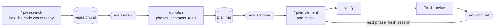

# 4. Skills and workflow

Instructions tell the agent about the project. Skills tell it how to carry out a task: the steps, the order, where to stop. This chapter covers how a skill works, how to write one that loads when it should, and the workflow this harness builds from four of them.

## What a skill is

A skill is a folder with a `SKILL.md` file: YAML frontmatter, then Markdown instructions. Optional files sit beside it. The format is an open specification that Claude Code, Cursor, Copilot, Codex, Gemini CLI and OpenCode all read.

```
.agents/skills/rpi-plan/
  SKILL.md                    frontmatter + the procedure
  resources/
    plan-format.md            read on every run
    store-github.md           read only for a GitHub issue URL
    store-gitlab.md           read only for a GitLab issue URL
```

### Three levels of loading

A skill costs context in three stages, and the design of a good skill follows from them.

| Level | What is loaded | When | Cost |
| --- | --- | --- | --- |
| 1 | `name` and `description` | Every session, for every installed skill | Always paid |
| 2 | The body of `SKILL.md` | When the skill is invoked | Paid per use |
| 3 | Files under `resources/` | When the body tells the agent to read one | Paid only when needed |

This is **progressive disclosure**: the agent sees a one-line summary of everything, and the detail of only what it uses. Fifty installed skills cost fifty descriptions, not fifty manuals.

It dictates how to write each level:

- **Description**: short, and precise about *when*. It is the only thing the model has when deciding whether to open the skill.
- **Body**: the procedure, under 300 lines here (`skill/size`). What the agent needs on every run.
- **Resources**: variants, formats, long examples. What it needs on some runs.

Upstream had seven planning and implementing skills, one per storage backend, with one 6 KB guideline file copied into four of them. Here `rpi-plan` is one skill, and the GitHub and GitLab procedures are level 3 files. A run that stores the plan as a file never loads them.

### The description is the trigger

For a skill that the model may invoke by itself, the description does two jobs: say what the skill does, and say when to use it, in words close to what a user would actually type.

```yaml
# Loads when it should
description: Write a handoff note that lets a fresh session continue this work with no other
  context. Use when the conversation is getting long, before clearing or compacting context,
  when stopping work for the day, or when the user asks to save where things are.

# Loads by luck
description: Handoff helper.
```

`harness check` requires a "Use when" sentence in every model-invocable description (`skill/trigger`) and rejects two skills with the same description (`skill/duplicate-description`).

### Who may start it

Some skills are safe for the model to start: committing when asked, reviewing a diff. Others have side effects that only you should trigger: creating a plan, implementing a phase, opening a pull request. The frontmatter says which:

```yaml
disable-model-invocation: true    # only the user can start it, with /rpi-plan
```

The linter requires this field to be written out in every skill (`skill/invocation`), so that it is a decision and not a default.

### Write one

```bash
node .agents/harness/cli.mjs new-skill release-notes --group git
```

This creates `.agents/skills/release-notes/SKILL.md` from the template. Then:

1. Write the description: what, and "Use when".
2. Write the body as numbered steps. For each step say what "done" looks like. Explain *why* where the reason lets the agent handle a case the steps do not cover.
3. End with boundaries: what the skill must not do.
4. If the model may invoke it, add cases to `evals/triggers.jsonl`: two prompts that should load it and one near-miss that should not.
5. Run `harness sync` and `harness check`.

Two rules keep skills portable ([convention](../conventions/skills/self-contained.md)): links stay inside the skill folder, and another skill is referred to by name, with a fallback for when it is not installed.

## The workflow: research, plan, implement

The largest failures of coding agents are not wrong lines. They are an hour of confident work on the wrong design, in the wrong place, on a wrong picture of the code. A workflow prevents that by separating three activities and putting a human check between them.



### Why three steps

- **Each step has a different failure, and a different cost of failure.** A wrong line of research (a misread of how the code works) produces a wrong plan. A wrong line of plan produces hundreds of wrong lines of code. A wrong line of code is one wrong line. Human attention is scarce, so it goes where an error is cheapest to catch and most expensive to miss: the research and the plan.
- **Each step produces a file.** `research.md` and `plan.md` under `.agents/plans/<date>-<task>/` are the handover between steps. A step can therefore start in a fresh session that has read only that file, with a context holding nothing but what matters.
- **The files are reviewable.** Two hundred lines of plan can be read properly. Two thousand lines of diff cannot.

### Research: facts with citations

`rpi-research` produces a description of how the code works today in the area a task will touch. Its rules:

- **Facts only.** No design, no opinions, no suggestions. Those belong in the plan.
- **Cite or drop.** Every claim carries a `path:line`. A claim without one is a guess and is left out.
- **Delegate the reading.** The main session sends read-only subagents to explore in parallel and receives their findings, not the files ([chapter 7](07-context.md)).
- **Record the commit.** The file notes the commit it was written against, so a later reader can tell how stale it is.

### Plan: vertical slices

`rpi-plan` turns a task into phases. The format is in [`plan-format.md`](../../.agents/skills/rpi-plan/resources/plan-format.md). The idea that carries the most weight:

> **A phase is a vertical slice.** It goes through every layer it needs (interface, logic, persistence, tests) for one behaviour, and after it the build passes and the commit makes sense alone.

Not "Phase 1: the database, Phase 2: the API, Phase 3: the UI". After Phase 1 of that plan nothing can be run, reviewed as behaviour, or shipped. Instead: "Phase 1: a user can apply a coupon (happy path, end to end). Phase 2: expired and invalid coupons."

Each phase lists its **public contracts** (signatures, payloads, schemas, user-facing text) and its **test strategy**, because those are what a reviewer can judge before code exists. And the skill creates nothing until you approve.

### Implement: one phase, then stop

`rpi-implement` implements the first phase that has unchecked tasks, verifies it, records progress in the plan, and stops. It does not commit, and it does not start the next phase.

Stopping is the feature. It gives you a small diff to review, a natural commit boundary, and the option to start the next phase in a fresh session whose only input is the plan. The checkboxes in the plan are the shared state: an interrupted session can be resumed from them, and the session-start hook reads them to tell a new session where the work stands.

### Review: a second pair of eyes that has not seen the work

The session that wrote a change reads its intentions into the diff. `fresh-review` starts a subagent that gets only the intent (from the plan) and the diff, has it report defects with the input that triggers each, and then has the main session **verify every finding** before reporting. Two details matter:

- The reviewer is given the intent and the diff, not the author's opinion. A reviewer that is handed a conclusion returns it.
- Findings are claims. Each is checked against the code and reported as confirmed, rejected (with the reason) or needing your call.

## Exercise

1. Write a skill for a task you repeat: release notes, a database migration, a dependency upgrade. Give it a "Use when" description.
2. In a fresh session, ask for that task in your own words, without naming the skill. Did it load? If not, the description is missing the words you used.
3. Run a small real task through `/rpi-plan` and `/rpi-implement`. Notice how much easier the plan is to review than the diff would have been.

Next: [guardrails](05-guardrails.md).
